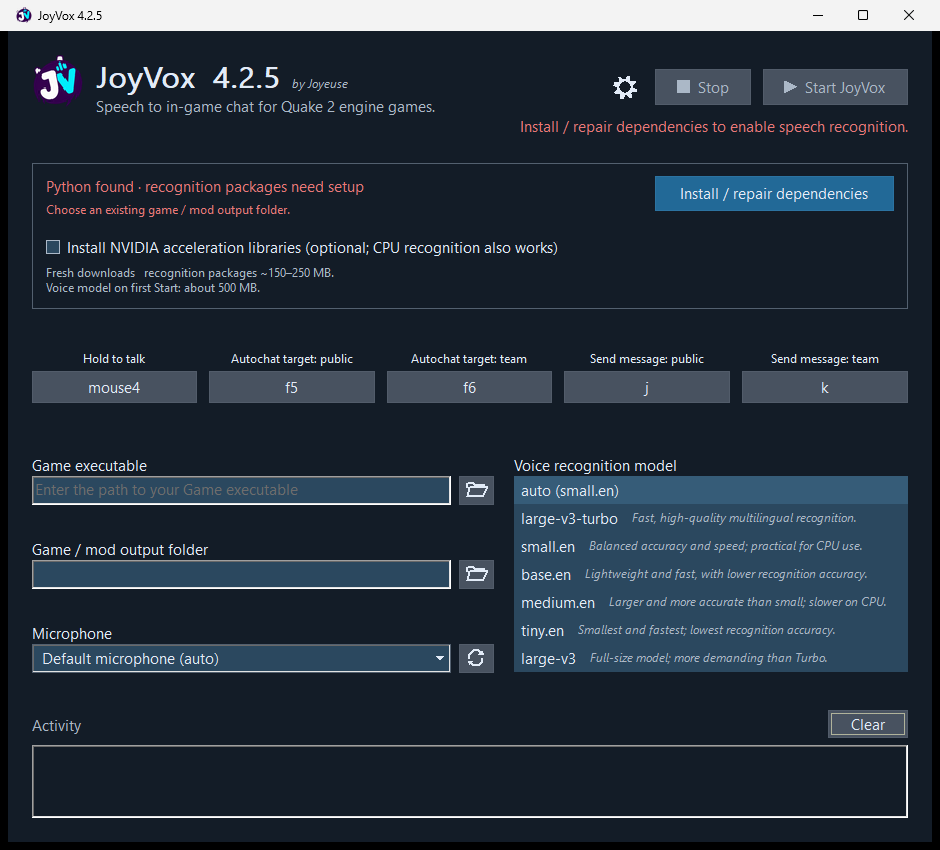
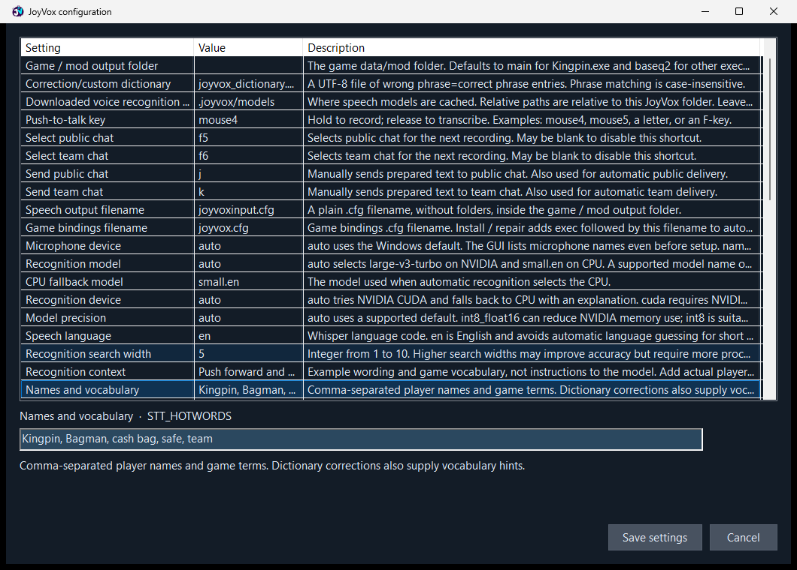

# JoyVox

**Turn your voice into in-game text chat.**

Hold a button, speak, and release to send your message to public or team chat.
JoyVox is built for **Kingpin** and designed to work with other **Quake II engine games**.

**[Download for Windows](https://github.com/kingjoyeuse/joyvox/releases/latest)** ·
[Report a problem](https://github.com/kingjoyeuse/joyvox/issues)



*The launcher before first-time setup, showing the default bindings and model choices.*

## Features

- **Public and team chat** with customizable keyboard and mouse bindings.
- **Local speech recognition.** Your microphone audio is not sent to a transcription service.
- **Automatic model selection** for your CPU or NVIDIA GPU, with other models available to choose.
- **Custom word and phrase corrections** for player names and terms the recognizer gets wrong.

## Get started

You need **Windows 10 or 11 on a 64-bit Intel/AMD PC**, a microphone, and a compatible game.
An NVIDIA GPU is optional. JoyVox handles its own recognition dependencies; you do not
need to install Python separately.

1. Download the **Windows portable ZIP** from the [latest release](https://github.com/kingjoyeuse/joyvox/releases/latest),
   extract it into a writable folder, and open **joyvox.exe**.
2. Select your **Game executable** and check the **Game / mod output folder**.
   This is usually `main` for Kingpin or `baseq2` for Quake II. Select your mod's
   folder if you play a mod.
3. Choose your **Microphone** and leave the voice recognition model on **auto**
   to use the default for your hardware.
4. Enable the NVIDIA libraries option if you want to use a compatible NVIDIA GPU,
   then click **Install / repair dependencies** to complete first-time setup.
   Setup also adds JoyVox's bindings to the game's startup configuration.
5. Click **Start JoyVox**, wait for **READY**, and launch your game separately.
   Keep JoyVox running while you play.

Setup requires an Internet connection. The selected voice model downloads on
first Start and is reused afterwards; depending on your model and GPU options,
downloads can total several gigabytes. Transcription runs on your computer.

If your game is already running, enter this once in its console:

```text
exec joyvox.cfg
```

## Controls

| Default control | Action |
| --- | --- |
| Hold **Mouse 4**, then release | Record, transcribe, and send your message |
| **F5** | Select public chat for subsequent recordings |
| **F6** | Select team chat for subsequent recordings |
| **J** | Manually send prepared text to public chat |
| **K** | Manually send prepared text to team chat |

Click any binding button in the launcher to change it. **Esc** cancels key capture.

Automatic sending is on by default and only happens while your selected game is
focused. Otherwise, the message stays prepared for **J** or **K**. For manual
sending only, set **Automatically send text** to **No** in Advanced settings.

## Make it yours

The **gear icon** opens Advanced settings for recognition language, vocabulary,
text formatting, sound effects, and more. Stop recognition before changing
settings, then start it again.



To fix recurring misheard words, edit `joyvox_dictionary.cfg` in your JoyVox folder.
Add one correction per line, then restart recognition:

```text
king pen=Kingpin
bag man=Bagman
```

Audio recordings are not saved by default. An optional diagnostic setting can
save the latest push-to-talk clip when you need to investigate recognition problems.

## Updating

Close JoyVox, then replace **joyvox.exe** with the one from the new release.
Keep your configuration, dictionary, `.joyvox` folder, and model cache.

## Help and project information

If text is recognized but does not appear in-game, check the game/mod folder,
make sure the game is focused, and try `exec joyvox.cfg` in its console.

[Report a problem or suggest a feature](https://github.com/kingjoyeuse/joyvox/issues) ·
[What's changed](CHANGELOG.md) ·
[Build from source](RELEASING.md#build-a-new-version) ·
[License and notices](NOTICE.md)

Made by [Joyeuse](https://github.com/kingjoyeuse).
